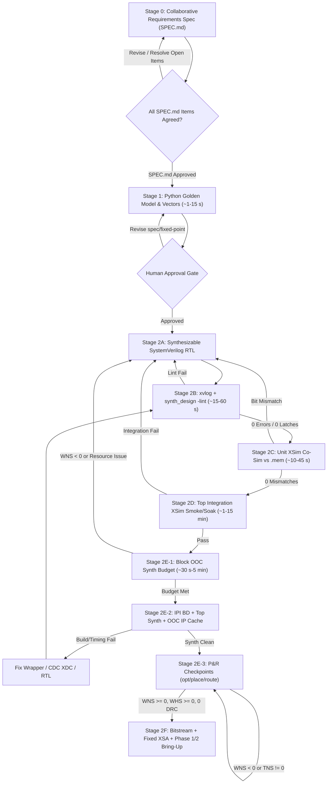

# Python-to-FPGA Engineering Playbook

This playbook documents **Path 2 (SPEC.md Requirements -> Python Golden Reference -> Direct SystemVerilog RTL -> Bitstream)**—a fast, deterministic methodology for turning DSP algorithms into timing-closed AMD/Xilinx FPGA bitstreams while keeping AI agents and engineers out of 30–90 minute EDA debugging traps.

It was extracted from an end-to-end 5G NR O-RAN vDU design deployed on an AMD Zynq UltraScale+ ZCU102 (`xczu9eg-ffvb1156-2-e` @ `245.761 MHz`), and comes pre-wired with a working 15-tap symmetric FIR canary block (`canary_fir`) so you can validate your local toolchain in minutes.

---

## 1. End-to-End Stage 0 → 2F Pipeline

The core principle is **explicit Stage 0 specification agreement + strict fast-loop vs. slow-gate separation**: align on every requirement in `SPEC.md` before modeling, then catch 99% of arithmetic, FSM, and syntax bugs in seconds (`Stage 1`, `2B`, `2C`) before ever invoking Vivado block design synthesis or Place & Route (`2E-2`, `2E-3`).



### Stage Timing & Exit Criteria

| Stage | Purpose | Typical Runtime | Mandatory Exit Criteria |
| :--- | :--- | :---: | :--- |
| **Stage 0** | Co-author [`SPEC.md`](../SPEC.md) (scope, target/clock/budget, math, fixed-point, interfaces/regmap, verification plan) from [`spec_template.md`](../.agents/plugins/python-to-fpga/skills/python-to-bitstream/references/spec_template.md) | Interactive / Collaborative | `0` open questions; **explicit mutual agreement on every item in `SPEC.md`** (`Status: APPROVED`) before any Python or RTL |
| **Stage 1** | Float vs. fixed-point Python model + `$readmemh` vectors matching `SPEC.md` | `~1–15 s` | Numerical checks pass `SPEC.md` thresholds (`<= 1–2` LSB fixed-point error); **explicit human sign-off** before any RTL |
| **Stage 2A** | Hand-authored, pipelined SV RTL (`rtl/*.sv`) + AXI4-Lite `VERSION` | Manual / `1–10 min` | Reset-free data delay lines, registered DSP/BRAM stages, skid buffers on async/subsystem ports |
| **Stage 2B** | `xvlog -sv` + Vivado `synth_design -lint` | `~15–60 s` | `0` syntax errors, `0` latch inferences, `0` multi-driven nets; lints Verilog-2001 BD wrapper too |
| **Stage 2C** | Per-block XSim co-simulation against `.mem` vectors | `~10–45 s` | `0` mismatches across randomized `tvalid` bubbles, `tready` stalls, and AXI-Lite config scenarios |
| **Stage 2D** | Top-level XSim integration (short smoke first, full soak later) | `~1–15 min` | `0` mismatches end-to-end; never debug block arithmetic here—drop back to Stage 2C |
| **Stage 2E-1** | Out-of-context (`-mode out_of_context`) block synthesis | `~30 s–5 min` | Meets target `WNS >= 0 ns`, expected `DSP48E2` / `SRLC16E` / `BRAM` inference confirmed |
| **Stage 2E-2** | IPI Block Design + `create_bd_cell` + Top Synth (OOC IP cached) | `~5–30 min` | `validate_bd_design` clean; `impl_cdc.xdc` tagged `USED_IN implementation`; `post_synth.dcp` written |
| **Stage 2E-3** | Checkpointed P&R (`opt_design`, `place_design`, `route_design`) | `~10–90 min` | `WNS >= 0`, `TNS = 0`, `WHS >= 0`, `THS = 0`, `WPWS >= 0`, 100% routed nets, `0` DRC errors |
| **Stage 2F** | `write_bitstream` + `write_hw_platform -fixed -include_bit` | `~3–8 min` | Phase 1 JTAG/PS/AXI-Lite `VERSION` readback passes; Phase 2 external I/O/PHY bench passes |

---

## 2. Adding a New DSP Block

Never start by creating an empty `.sv` file—or even writing Stage 1 Python code—before agreeing on requirements. First complete **Stage 0 (`SPEC.md`)**, then scaffold the full Stage 1 -> Stage 2C slice together using [`scaffold_block.py`](../.agents/plugins/python-to-fpga/skills/python-to-bitstream/scripts/scaffold_block.py):

```powershell
py .agents/plugins/python-to-fpga/skills/python-to-bitstream/scripts/scaffold_block.py --block my_filter --repo . --magic MYF1
```

This creates:
1. `python/my_filter_golden.py` — Stage 1 float + fixed-point reference template and self-test harness.
2. `python/generate_my_filter_vectors.py` — `$readmemh` stimulus and expected output exporter (`test_vectors/`).
3. `rtl/my_filter.sv` — Synthesizable SV starter with AXI4-Lite `VERSION` (`0x000` -> `"MYF1"`), AXI4-Stream handshake, and reset-free data pipeline comments.
4. `tb/tb_my_filter.sv`, `sim/run_sim_my_filter.bat`, `sim/run_sim_my_filter.sh` — Cross-platform Stage 2C XSim runners with explicit `xsimk.exe` checks and cleanup.

**Workflow for every new block:**
1. **Stage 0:** Copy [`spec_template.md`](../.agents/plugins/python-to-fpga/skills/python-to-bitstream/references/spec_template.md) to `SPEC.md` and co-author all sections (scope, part/clock/budget, algorithm, fixed-point formats, register map, verification criteria, and open questions) until **both parties agree on every item** (`Status: APPROVED`).
2. Run `scaffold_block.py` to generate the Stage 1–2C file layout, then implement the math + fixed-point bit-exact model in `python/<block>_golden.py` matching `SPEC.md`. Run it and inspect metrics/plots.
3. Generate `.mem` vectors via `python/generate_<block>_vectors.py`.
4. **Stop for review/approval** of the fixed-point bit widths, rounding mode, and resource strategy (updating `SPEC.md` if any requirements changed).
5. Implement `rtl/<block>.sv`, add it to `vivado/run_lint.tcl` and `sim/run_lint.*`, and run `sim/run_lint.*` (Stage 2B).
6. Run `sim/run_sim_<block>.*` until `0 ERRORS` (Stage 2C), then benchmark with Stage 2E-1 OOC synthesis before wiring into a Block Design.

---

## 3. Adapting to Another FPGA Part or Board

All board-specific constants live in [`vivado/board_config.tcl`](../vivado/board_config.tcl), which reads optional environment variables before falling back to ZCU102 defaults:

| Variable | Default (`xczu9eg`) | Purpose |
| :--- | :--- | :--- |
| `FPGA_PART` | `xczu9eg-ffvb1156-2-e` | Target Xilinx/AMD device part string |
| `FPGA_BOARD_PART` | `xilinx.com:zcu102:part0:3.4` | Board preset (set `""` if targeting a bare part with no board repo) |
| `FPGA_CLK_MHZ` | `245.761` | Core PL fabric target frequency (MHz) |
| `FPGA_BUILD_DIR` | `%TEMP%/python_to_fpga_canary` (or `/tmp/...`) | Isolated out-of-tree Vivado build folder (keeps OneDrive / non-ASCII paths out of `.xpr`) |

Example override for a Kria KV260 (`xck26-sfvc784-2LV-c`) in PowerShell:
```powershell
$env:FPGA_PART = "xck26-sfvc784-2LV-c"
$env:FPGA_BOARD_PART = "xilinx.com:kv260_som:part0:1.4"
$env:FPGA_CLK_MHZ = "250.0"
vivado -mode batch -nojournal -nolog -source vivado/run_ooc_synth.tcl
```

> [!NOTE]
> If targeting a non-Zynq UltraScale+ FPGA (e.g., Artix-7, Kintex-7, Versal), replace the `zynq_ultra_ps_e` and `apply_bd_automation` block in [`vivado/create_bd.tcl`](../vivado/create_bd.tcl) with Zynq-7000, MicroBlaze, or Versal CIPS + NoC, and update the pin locations in [`vivado/constraints.xdc`](../vivado/constraints.xdc). Keep the Verilog-2001 `*_bd_wrapper.v` and `impl_cdc.xdc` (`USED_IN implementation`) split unchanged.

---

## 4. Phase 1 vs. Phase 2 Hardware Bring-Up

Never debug algorithmic logic, PS-PL bridges, and external SerDes/RF transceivers at the same time. Always follow [`bringup/README_BRINGUP.md`](../bringup/README_BRINGUP.md):

- **Phase 1 — Standalone Board Smoke Test (no external RF/FMC/SFP cables needed):**
  - Configure boot switches to **JTAG mode** (e.g., `SW6 = 0000` on ZCU102).
  - Run [`bringup/jtag_bringup.tcl`](../bringup/jtag_bringup.tcl) via `xsdb`.
  - Verify `psu_init` -> `fpga` -> `psu_post_config` -> `psu_ps_pl_isolation_removal` -> `psu_ps_pl_reset_config` succeeds and `VERSION` at `0xA0000000` reads back the expected 4-byte ASCII ID (`0x46495231` `"FIR1"` for the canary).
  - Exercise AXI4-Lite registers and PS-to-PL AXI DMA loopback (`MM2S -> IP -> S2MM`) to confirm clocks, resets, and bit-exact silicon output.
- **Phase 2 — Full System / External I/O Bench Test:**
  - Connect external optical/FMC/clock sources (SFP+, JESD204C FMC, 10 MHz / 1 PPS reference, `SYSREF`).
  - Confirm external PLL locks and link telemetry before evaluating DSP ACLR/EVM on bench analyzers.

---

## 5. Lessons Learned & Pitfalls Catalog

Every hard-won pitfall discovered during our ZCU102 5G O-RAN bitstream build is cataloged in structured **Stage & Trigger -> Failure Mode -> Preventive Pattern -> Verification Check** format in:
- [`lessons_learned.md`](../.agents/plugins/python-to-fpga/skills/python-to-bitstream/references/lessons_learned.md) (13 battle-tested rules covering fixed-point `.mem` sign/shift parity, `SRLC16E` reset-free inference, AXI4-Stream skid draining, TDM LUT reduction, `xelab` silent Windows failures, non-ASCII/OneDrive Vivado path crashes, Verilog-2001 IPI wrappers, dynamic `pl_clk0` reads, `USED_IN implementation` CDC XDCs, OOC caching, and XSDB `psu_ps_pl_isolation_removal`).
- [`vivado_recipes.md`](../.agents/plugins/python-to-fpga/skills/python-to-bitstream/references/vivado_recipes.md) (copy-pasteable Tcl, Verilog-2001 attribute, XDC, and XSDB snippets).
